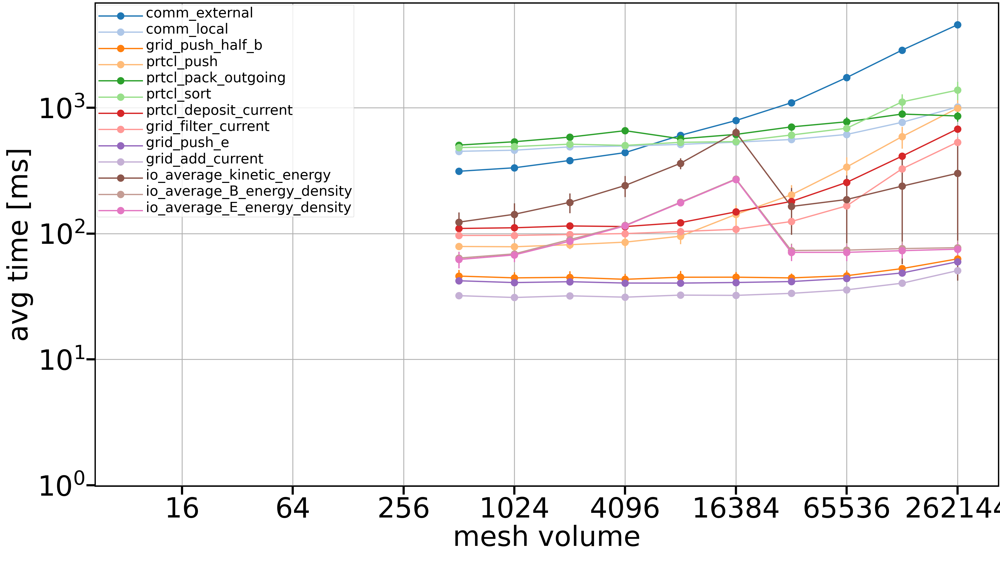

# Profiling experiment

This experiment traces the python functions that are called through the `self._action(name, *vargs, **kwargs)`
in `method_wrapper.py`. By applying the patch in this directory, one can change the `method_wrapper` to include
the needed changes.

The patch was made againts commit `e6420fc37c3102baa34bd78b14671828ad24b6e8`.

To apply it, do `git apply path/to/this/method_wrapper_viztracer.patch` in the root of the runko directory.

`viztracer` needs to be installed for the experiment to work.

## Running the experiment

Use `sbatch submit.sh` to run the experiment on LUMI.

We use `sed` to change the number of cells per tile,
then run the experiment using sparse logging of `viztracer` to only log the function calls we've
explicitly marked in the files. Then we combine the files
generated by each process to a single file called e.g. `mesh_8_8_8.json` for the case of `n[xyz]mesh = 8`.

## Plotting the data

Use `plot_from_trace_data.py` on e.g. your own laptop to plot data from the trace files.

If you've copied the trace files (e.g. `mesh_8_8_8.json`, `mesh_16_8_8.json` and `mesh_16_16_8.json`) to `/path/to/files`
on your laptop, then plot the data with `python plot_from_trace_data.py /path/to/files/mesh_ 8_8_8 16_8_8 16_16_8`.
The script reads the three files and plots data similar to .
